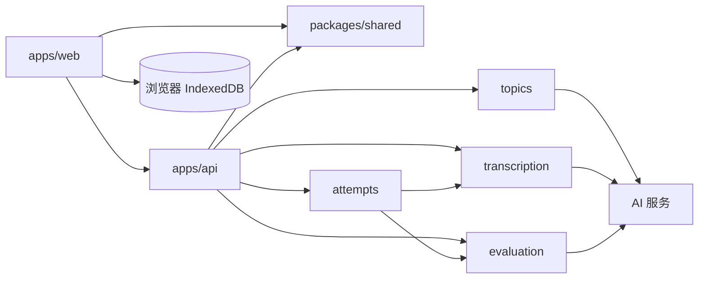

# 表达能力锻炼系统设计

## 目标与范围

让单个用户通过辩证性论题、录音作答和有依据的 AI 反馈练习表达。首版流程：获取论题 → 录音 → 自动转写与评估 → 在同一页面阅读回答文本和反馈 → 同题再答一次。

P0：AI 生成论题（失败时使用预置题库）、用户主动换题、录音与重录、只读转写文本、结构化评估、同题两次回答对比、基本错误提示。经用户确认增加 IndexedDB 浏览器练习历史。其余 P1：按主题出题、准备提示、基于音频的语速与停顿分析。无需导出、账户或多人功能。

仅依据转写文本评价观点与论证、结构与连贯、表达清晰度。语速与停顿不能从文本可靠推断，须有音频分析能力后再提供。

## 技术方案：方案 A

- Monorepo：pnpm workspace + Turborepo。
- 前端：React + Vite，负责单页论题展示、浏览器录音、只读转写文本、反馈和结果对比。
- 后端：NestJS，同步调用 AI 出题、语音转写和评估服务。单次录音上限暂定 3 分钟，避免请求等待过长。
- 提交录音后，后端同步完成转写与评估，并返回原始转写文本和反馈。用户可阅读转写文本，但不能编辑或借由文字输入代替口头作答。音频在处理完成后不持久保存。
- 当前页面状态由 React 维护；成功作答后由前端写入 IndexedDB。刷新后可从当前浏览器历史恢复，一轮的练习可继续第二轮。后端无状态，不保存历史。
- 外部数据仅在 API 边界校验。AI 评估结果在服务端校验为固定结构，再交给前端使用。

### 目录

```text
apps/
  web/                 React + Vite
  api/                 NestJS
    src/topics/        出题与预置题库
    src/transcription/ 录音转写
    src/evaluation/    回答评估
packages/
  shared/              前后端共享的数据类型
pnpm-workspace.yaml
turbo.json
```

### 模块依赖



### 数据模型

| 模型 | 字段 | 用途 |
| --- | --- | --- |
| Topic | id, title, description, source, createdAt | 论题；source 为 AI 或预置题库 |
| Attempt | id, topicId, round, transcript, durationSeconds, createdAt | 一次作答；round 为 1 或 2 |
| Evaluation | attemptId, summary, featuredQuote, dimensions, strengths, issues, nextStep | 一次作答的反馈 |
| Practice | id, topic, results, createdAt, updatedAt | 一次练习，关联一至两轮作答和反馈 |
| DimensionFeedback | name, score, reason, suggestion | 单维度评分及具体依据 |

维度固定为“观点与论证”“结构与连贯”“表达清晰度”。反馈应尽可能引用回答中的具体内容，不只给笼统分数。

## 视觉设计

界面基调为安静、专注的练习空间。采用炭黑与灰白构成中性色体系：主要按钮以炭黑底和白字突出，当前步骤通过文字重量与位置体现；背景使用浅灰白 `#F7F7F5`，正文使用炭黑 `#222222`。成功与错误状态只在必要处使用语义色，并配合文字说明；评分不能只依赖颜色传达。

页眉仅显示“言序”文字名称，当前版本不使用图形 Logo 或自定义浏览器图标。

### Design tokens

| Token | 值 | 用途 |
| --- | --- | --- |
| `color.brand` | `#222222` | 主操作、焦点与强调 |
| `color.brandHover` | `#3A3A3A` | 主操作悬停 |
| `color.background` | `#F7F7F5` | 页面背景 |
| `color.surface` | `#FFFFFF` | 卡片及输入区域 |
| `color.text` | `#222222` | 主要文字 |
| `color.textMuted` | `#626262` | 次要文字 |
| `color.border` | `#E2E2DE` | 分隔与边框 |
| `color.mic` | `#555555` | 麦克风图标及录音中状态 |
| `color.micSurface` | `#EEEEEC` | 麦克风默认背景 |
| `color.micBorder` | `#D4D4D0` | 麦克风默认边框 |
| `color.success` | `#15803D` | 完成状态 |
| `color.error` | `#B91C1C` | 错误状态 |
| `radius.card` | `16px` | 内容卡片 |
| `radius.control` | `10px` | 按钮与输入框 |
| `space.unit` | `4px` | 间距基准，常用 8/16/24/32px |
| `content.maxWidth` | `800px` | 练习内容最大宽度 |
| `type.body` | `16px / 1.6` | 正文 |
| `type.heading` | `28px / 1.3` | 页面标题 |

论题、录音入口、只读回答文本和反馈位于同一页面。论题旁提供“换一题”；换题后清空当前练习状态。麦克风位于作答区中央，采用浅灰色圆面与中灰色图标；录音中使用深灰色实心状态。随练习状态逐步展示内容，每个状态只突出一个主操作。反馈优先呈现可执行建议和对应的回答片段，再呈现维度分数。移动端保持单列布局。

Avoid unneccessary secondary labels and decsriptions. Let the layout do the axplaning

## 开发顺序与验收

### 后端实施阶段

| 阶段 | 范围与验收 | 状态 |
| --- | --- | --- |
| R1 | 确定 Qwen3-ASR-Flash 转写、GPT-6 Luna 出题评估；定义共享接口类型、错误格式和配置清单，详见 [接口契约](docs/api-contract.md) | 已完成；服务配置与少量真实调用已验证 |
| R2 | 整理 NestJS 模块、加载本地环境变量、配置 CORS 与异常响应；健康检查可用 | 已完成 |
| R3 | 实现 AI 论题接口，失败时回退预置题库 | 已完成；真实出题通过 |
| R4 | 实现录音上传及 Qwen 转写 | 已完成；真实 WAV 转写与本地 WebM 上传通过 |
| R5 | 实现三维评估与结构校验，反馈具有具体依据 | 已完成；真实短回答评估通过 |
| R6 | 串联一次作答接口，同步返回转写和评估 | 已完成；模拟完整流程通过 |
| R7 | 联调前端录音、换题、结果与同题重答 | 已完成；Chrome 本地模拟浏览器全流程通过 |
| R8 | 核对常见异常恢复、更新启动说明并交付 | 已完成，见 [验收记录](docs/acceptance.md) |

R1 只确定契约，不表示业务接口已可调用。每阶段完成后核对差异并提交；版本记录按用户可见的阶段成果合并。

### 整体开发顺序

1. 建立 workspace、Turborepo、React、NestJS：根目录可启动前后端，前端能请求健康检查接口。
2. 定义共享类型并实现论题接口：AI 可生成论题，服务失败时返回预置论题；用户可主动换题。
3. 实现录音界面：可开始、结束、重录，并提示麦克风权限问题。
4. 实现录音处理接口：上传录音后自动转写并评估，返回只读展示用的文本和固定结构的三维反馈。
5. 串联单页结果与同题重答：论题始终可见，完成两次作答并查看对应反馈，建议包含具体依据。
6. 完善异常提示和 README：空录音、转写失败、评估失败均有清楚的恢复方式；新环境可按文档启动。

## IndexedDB 浏览器历史与 Vercel

浏览器数据库 `yanxu`，版本 1，object store 为 `practices`，以 Practice.id 为 key。每次成功作答后以一次 readwrite 事务保存完整 Practice；results 最多两轮，后续作答使用同一练习 ID 更新。列表按更新时间倒序，每页展示 20 条。针对单用户小数据量，读取后在内存排序分页，不额外引入索引或依赖。

Practice.id 只用于浏览器归档，不再发送给后端。服务端校验 round 为 1 或 2，不查询历史；前端负责首轮、第二轮及结果对比。AI 请求失败不写入历史；本地写入失败保留已生成反馈，允许只重试保存，也可明确放弃保存后继续使用。

前端与 NestJS 分别作为两个 Vercel 项目部署。NestJS 使用官方可识别的 src/main.ts 入口，监听平台 PORT；maxDuration 为 150 秒，上游转写与评估各 60 秒，前端等待 135 秒。WEB_ORIGIN 规范化为一个精确来源，不开放通配跨域。录音上传上限为 4 MiB，metadata 上限 16 KiB，给平台 4.5 MB 请求体限制预留空间。部署步骤见 [Vercel 指南](docs/deployment-vercel.md)。

不保存音频，不加入删除、导出、账户或云同步。旧 SQLite 文件不删除、不自动迁移；浏览器历史隔离到当前来源和设备，清除站点数据可能丢失。原 R1–R8 验收属于历史阶段，本次仅执行构建及静态核对，未追加真实模型调用或自动化测试。
