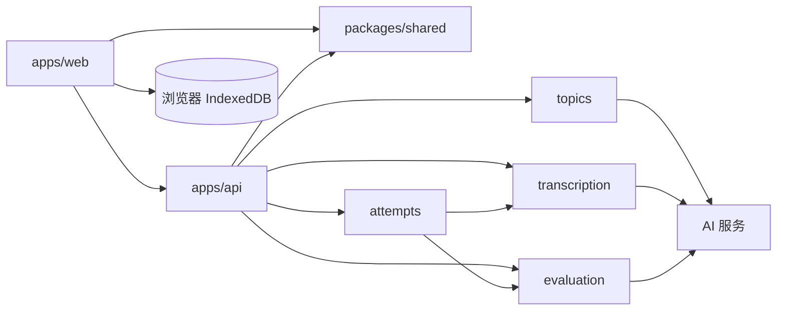

# 表达能力锻炼系统设计

本文记录产品范围、技术方案与视觉设计。实施顺序见 [开发计划](docs/development-plan.md)，检查结果见 [验收记录](docs/acceptance.md)。

## 目标与范围

让单个用户通过辩证性论题、录音作答和有依据的 AI 反馈练习表达。首版流程：获取论题 → 录音 → 自动转写与评估 → 在同一页面阅读回答文本和反馈 → 同题再答一次。

P0：AI 生成论题（失败时使用预置题库）、用户主动换题、录音与重录、只读转写文本、结构化评估、同题两次回答对比、基本错误提示。经用户确认增加 IndexedDB 浏览器练习历史。其余 P1：按主题出题、准备提示、基于音频的语速与停顿分析。无需导出、账户或多人功能。

仅依据转写文本评价观点与论证、结构与连贯、表达清晰度、论题回应度、具体性与例证、权衡与边界。语速与停顿不能从文本可靠推断，须有音频分析能力后再提供。

## 技术方案：方案 A

- Monorepo：pnpm workspace + Turborepo。
- 前端样式使用 Less Modules（`*.module.less`），组件通过导入的模块映射引用类名；页面基础样式与设计变量保留全局作用域。
- 前端：React + Vite，负责单页论题展示、浏览器录音、只读转写文本、反馈和结果对比。
- 后端：NestJS，同步调用 AI 出题、语音转写和评估服务。单次录音上限暂定 3 分钟，避免请求等待过长。
- 提交录音后，后端同步完成转写与评估，并返回原始转写文本和反馈。用户可阅读转写文本，但不能编辑或借由文字输入代替口头作答。音频在处理完成后不持久保存。
- 当前页面状态由 React 维护；成功作答后由前端写入 IndexedDB。刷新后可从当前浏览器历史恢复，一轮的练习可继续第二轮。后端无状态，不保存历史。
- 外部数据仅在 API 边界校验。AI 评估结果在服务端校验为固定结构，再交给前端使用。

### 目录

```text
apps/
  web/                 React + Vite
  api/                 NestJS
    src/topics/        出题与预置题库
    src/transcription/ 录音转写
    src/evaluation/    回答评估
packages/
  shared/              前后端共享的数据类型
pnpm-workspace.yaml
turbo.json
```

### 模块依赖



### 数据模型

| 模型 | 字段 | 用途 |
| --- | --- | --- |
| Topic | id, title, description, source, createdAt | 论题；source 为 AI 或预置题库 |
| Attempt | id, topicId, round, transcript, durationSeconds, createdAt | 一次作答；round 为 1 或 2 |
| Evaluation | attemptId, overallScore, summary, evidenceQuotes, dimensions, strengths, issues, nextStep | 一次作答的反馈；总分为六维均分 |
| Practice | id, topic, results, createdAt, updatedAt | 一次练习，关联一至两轮作答和反馈 |
| DimensionFeedback | name, score, reason, suggestion | 单维度评分及具体依据 |

维度固定为“观点与论证”“结构与连贯”“表达清晰度”“论题回应度”“具体性与例证”“权衡与边界”。评分对短、泛、缺少例证或漏题回答从严；反馈应尽可能引用回答中的具体内容，不只给笼统分数。

## 视觉设计

界面基调为有灰色小水獭陪伴的安静练习空间。背景暖白 `#FAF9F6`，正文炭灰 `#33363B`，主要操作使用深灰蓝 `#526579`，浅灰蓝 `#EDF1F5` 用于水面衬底和练习建议。保留白色内容卡片和清晰留白，不使用绿色装饰、渐变分数卡或彩虹色导图。错误状态保留语义色与文字说明。

复用现有小水獭素材：准备、回听、处理和反馈时显示原动画首帧，录音时播放原 GIF；减少动态效果偏好下始终使用静态图片。形象固定在内容区域，不跟随分数改变情绪，不添加新的角色或未经制作的动作。

页眉仅显示“言序”文字名称，当前版本不使用图形 Logo 或自定义浏览器图标。

### Design tokens

| Token | 值 | 用途 |
| --- | --- | --- |
| `color.brand` | `#526579` | 主操作、焦点与强调 |
| `color.brandHover` | `#425568` | 主操作悬停 |
| `color.background` | `#FAF9F6` | 页面背景 |
| `color.surface` | `#FFFFFF` | 卡片及输入区域 |
| `color.text` | `#33363B` | 主要文字 |
| `color.textMuted` | `#666B72` | 次要文字 |
| `color.border` | `#E1E4E7` | 分隔与边框 |
| `color.mic` | `#526579` | 麦克风图标及录音中状态 |
| `color.micSurface` | `#EDF1F5` | 麦克风默认背景 |
| `color.micBorder` | `#CBD4DE` | 麦克风默认边框 |
| `color.success` | `#15803D` | 完成状态 |
| `color.error` | `#B91C1C` | 错误状态 |
| `radius.card` | `16px` | 内容卡片 |
| `radius.control` | `10px` | 按钮与输入框 |
| `space.unit` | `4px` | 间距基准，常用 8/16/24/32px |
| `content.maxWidth` | `800px` | 练习内容最大宽度 |
| `type.body` | `16px / 1.6` | 正文 |
| `type.heading` | `28px / 1.3` | 页面标题 |

论题、录音入口、只读回答文本和反馈位于同一页面。论题旁提供“换一题”；换题后清空当前练习状态。小水獭与麦克风在作答区中央形成固定组合，配合对应状态的一句轻量提示；录音中保留明确的结束按钮与计时。每个状态只突出一个主操作。反馈依次展示总结、原话中的亮点与改进依据、下一步建议与重答入口，再呈现低调总分；思维导图、六维详情和参考答案通过原生 details 按需展开。移动端保持单列布局。

Avoid unneccessary secondary labels and decsriptions. Let the layout do the axplaning

## IndexedDB 浏览器历史与 Vercel

浏览器数据库 `yanxu`，版本 1，object store 为 `practices`，以 Practice.id 为 key。每次成功作答后以一次 readwrite 事务保存完整 Practice；results 最多两轮，后续作答使用同一练习 ID 更新。列表按更新时间倒序，每页展示 20 条。针对单用户小数据量，读取后在内存排序分页，不额外引入索引或依赖。

Practice.id 只用于浏览器归档，不再发送给后端。服务端校验 round 为 1 或 2，不查询历史；前端负责首轮、第二轮及结果对比。AI 请求失败不写入历史；本地写入失败保留已生成反馈，允许只重试保存，也可明确放弃保存后继续使用。

前端与 NestJS 分别作为两个 Vercel 项目部署。NestJS 使用官方可识别的 src/main.ts 入口，监听平台 PORT；函数时限通过 Vercel 控制台设置为 150 秒（Fluid Compute 默认 300 秒也足够），不在 vercel.json 中匹配 src/main.ts，上游转写与评估各 60 秒，前端等待 135 秒。WEB_ORIGIN 规范化为一个精确来源，不开放通配跨域。录音上传上限为 4 MiB，metadata 上限 16 KiB，给平台 4.5 MB 请求体限制预留空间。部署步骤见 [Vercel 指南](docs/deployment-vercel.md)。

不保存音频，不加入删除、导出、账户或云同步。旧 SQLite 文件不删除、不自动迁移；浏览器历史隔离到当前来源和设备，清除站点数据可能丢失。
